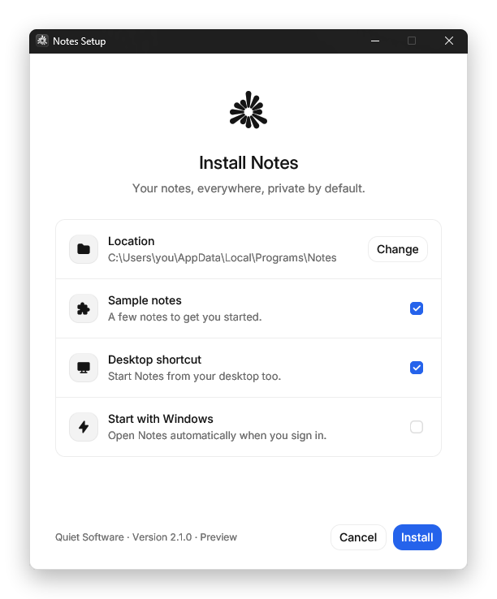
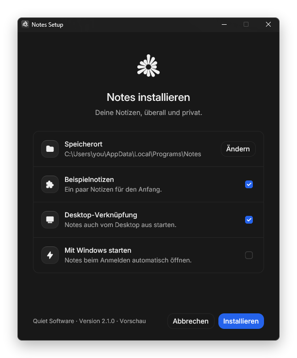

<p align="center">
  
</p>

<h1 align="center">Bach Installer</h1>

<p align="center">
  <strong>One <code>bach.toml</code> in, one <code>Setup.exe</code> out.</strong><br>
  Windows installers (and macOS ones) with a native window, in-place updates and a clean uninstaller,<br>
  without an installer script and without an administrator prompt.
</p>

<p align="center">
  <a href="https://github.com/usebach/bach-installer/actions/workflows/ci.yml"></a>
  <a href="https://github.com/usebach/bach-installer/releases/latest"></a>
  <a href="LICENSE"></a>
</p>

<p align="center">
  <a href="https://usebach.app/docs/quickstart">Quickstart</a> ·
  <a href="https://usebach.app/docs">Docs</a> ·
  <a href="https://usebach.app/docs/reference/config/overview">Config reference</a> ·
  <a href="https://github.com/usebach/bach-installer/releases">Releases</a> ·
  <a href="CHANGELOG.md">Changelog</a>
</p>

<p align="center">
  
  
</p>

Bach Installer packs the folder your app builds into, plus a short config file, into a
single setup file. Your users get one calm window in their own language; you
get updates over older installs and an uninstaller in **Settings › Apps**,
without writing installer logic.

## Quick start

Install the `bach` command (Windows, macOS and Linux; Node.js 18 or newer; no
Rust, no administrator rights):

```bash
npm install --global @usebach/cli
```

No Node.js? [Other ways to install](#other-ways-to-install) has a one-line
script for each system, Scoop, a GitHub Action and a zip file.

Then, in your project:

```bash
bach init      # writes a commented bach.toml (and, on GitHub, a release workflow)
bach check     # validates it and lists every file the installer will carry
bach preview   # opens the real window; nothing is installed
bach build     # writes the setup file
```

A complete config for a Rust app:

```toml
# bach.toml
[app]
name = "Hello"
version = "1.0.0"
publisher = "Hello Inc."
executable = "hello.exe"

[files]
source = "target/release"
exclude = ["*.pdb", "deps/**", "build/**"]
```

```console
$ bach build
Wrote dist\Hello-Setup-1.0.0.exe (9.7 MB)
  Packed       101.8 KB of 216.5 KB (47%), in 0.9s
```

[examples/hello](examples/hello) is a working project to try it on, and
[getting started](docs/getting-started.md) walks through it step by step. In a
GitHub repository, `bach init` also adds a one-click release: commit it, then
press **Actions › Release › Run workflow** ([releasing](docs/releasing.md)).

## Why Bach Installer

[NSIS](https://nsis.sourceforge.io), [Inno Setup](https://jrsoftware.org/isinfo.php)
and [WiX](https://wixtoolset.org) can build almost any installer, and ask you
to learn a scripting language or an XML schema to do it. Bach Installer covers the common
case, an app that installs for one user, with settings instead of code:

- **No script.** Everything is a setting in one TOML file with an
  [editor schema](schema/bach.schema.json). Every mistake is reported as one
  sentence naming the setting at fault.
- **No admin prompt unless you want one.** Apps install per user into
  `%LOCALAPPDATA%\Programs` and only write to the user's own folders and
  `HKCU`. For every user of a computer, `scope = "machine"` installs into
  `%ProgramFiles%` after one Windows prompt.
- **Updates that can't half-fail.** A newer setup file updates an install in
  place: files are unpacked first and swapped in together, and if one is
  locked, everything is put back. Files the new version no longer ships are
  removed.
- **A window people can read.** 19 languages built in, following the Windows
  display language; light and dark mode (and Windows contrast themes); every
  text replaceable; every choice reachable with Tab.
- **Builds anywhere.** `bach` runs on Windows, macOS and Linux, so installers
  can come out of any CI. Setup files need no .NET and no Visual C++ runtime.
- **Windows and macOS from one file.** Add a `[macos]` section and
  `bach build` also writes a Setup app in a `.dmg`: the same window, the same
  updates over older installs, optional open at login and links, all per user,
  with no administrator prompt. A Mac app that is one bundle goes straight into Applications,
  and moving it to the Trash removes it. See
  [`[macos]`](docs/config.md#macos).

**Use something else when** you need drivers, custom install-time scripts, or
a small stub: a Bach Installer setup file adds about 10 MB to your app. For Group Policy
and Intune, `bach build --msi` also writes a Windows Installer package.

## What setup files can do

| | |
| --- | --- |
| **Choices** | Desktop and Start menu shortcuts, start with Windows, add to `PATH`, each offered ticked, unticked, always or never; optional components, even ones downloaded when ticked |
| **Integration** | `myapp://` link schemes, file types and right-click entries, never taking over another app's; Windows services and firewall rules for machine-wide installs |
| **Look and words** | 14 built-in styles (soft gradients, terminal, game looks, ...) and 10 layouts, or your own fonts, colours, corners, pictures, logo and icon; light, dark or system theme; any text, per language; a license page |
| **Safety** | Free-space check, archive checksum, one setup per app at a time, "close and continue" when the app is open, data deleted only on request |
| **Updates** | Over older installs always; by themselves in the background from GitHub releases (or any https feed, optionally signed), installed when the app is closed, undone cleanly if a power cut interrupts them; patches with only the changed files. See [updates](docs/updates.md) |
| **Automation** | `Setup.exe /S` with `--dir`, `--with`, `--without`, `--log`; quiet uninstall from Settings › Apps |
| **Deployment** | An online installer that always downloads the newest version; access keys that encrypt the files and keep updates private; an ARM64 build next to x64; profiles (a portable ZIP, a company version); an `.msi`; winget, Chocolatey and Intune output |

Every setting is in the [config reference](docs/config.md).

## Commands

| Command | What it does |
| --- | --- |
| `bach import` | Writes a first `bach.toml` from an Inno Setup or NSIS script, and lists what it couldn't convert |
| `bach init` | Writes a starter `bach.toml`, filled in for Rust, Tauri, Electron, .NET, Godot and Unity projects, plus a release workflow in a GitHub checkout |
| `bach check` | Validates the config and lists every file and option; `--strict` turns a warning into an error |
| `bach preview` | Opens the real window without installing (the Windows one on Windows, the macOS one on a Mac); try `--theme dark`, `--lang de`, `--style arcade`, `--layout showcase` |
| `bach watch` | Like `preview`, and reopens the window every time you save `bach.toml` |
| `bach build` | Writes the setup file of every platform bach.toml describes (`--platform windows\|macos`); `--online`, `--msi`, `--pkg`, `--patch-from OLD.exe`, `--profile NAME`, `--sign` and more |
| `bach styles`, `bach layouts` | List the built-in styles and layouts |
| `bach inspect`, `bach verify`, `bach diff` | Show what a setup file carries, check it for damage, compare two versions |
| `bach test` | Installs, starts and removes a setup file in Windows Sandbox (or, with `--here`, on a CI runner) and reports what failed or was left behind |
| `bach sign`, `bach key`, `bach feed-key` | Sign a setup file, make access keys, make the key that signs update feeds |
| `bach feed`, `bach page`, `bach winget`, `bach choco`, `bach intune` | Write the update feed, a download page, and the winget, Chocolatey and Intune packages |
| `bach version`, `bach workflow` | Raise the version in every file at once; add the one-click release workflow (`--macos` adds a Mac job) |
| `bach doctor`, `bach update` | Check that a build can run; update `bach` itself |

Run `bach` on its own for this list grouped by what you are doing, and `bach COMMAND --help` for the options of one command. Every flag is in the [CLI reference](https://usebach.app/docs/reference/cli/overview).

## Other ways to install

- **PowerShell** (installs to `%LOCALAPPDATA%\Programs\bach-cli` and adds it to `PATH`):

  ```powershell
  irm https://raw.githubusercontent.com/usebach/bach-installer/main/install.ps1 | iex
  ```

- **macOS or Linux**, for building installers in CI (a Mac also builds and tests the macOS Setup app):

  ```bash
  curl -fsSL https://raw.githubusercontent.com/usebach/bach-installer/main/install.sh | sh
  ```

- **Scoop:** `scoop install https://raw.githubusercontent.com/usebach/bach-installer/main/scoop/bach.json`
- **npm** also works per project (`--save-dev`, then `npx bach`).
- **By hand:** download `bach-<version>-windows-x64.zip` from
  [releases](https://github.com/usebach/bach-installer/releases) and keep `bach.exe` and
  `bach-setup.exe` together.
- **GitHub Actions**, on any runner. This builds and publishes a release for
  every pushed tag like `v1.4.0`; the tag is the app's version, and installed
  apps update from it ([updates](docs/updates.md)):

  ```yaml
  permissions:
    contents: write
  steps:
    - uses: actions/checkout@v4
    # ... build your app ...
    - uses: usebach/bach-installer@v0
      with:
        config: bach.toml
        release: true
  ```

  Leave out `release: true` to only build; the file's path is the step's
  `setup` output. `@v0` follows the newest 0.x release, `@v0.2` the newest
  0.2.x, `@v0.2.1` never moves.

The install scripts install per user and never ask for administrator rights;
the [install docs](https://usebach.app/docs/installation) cover a system-wide
install. `bach update` keeps `bach` current: it checks the SHA-256 published
next to each release and puts the old files back if a step fails. A `bach`
installed by npm, Scoop, winget or Cargo is updated by that tool, and
`bach update` names the command. `BACH_NO_UPDATE_CHECK=1` turns the notice off.

Coding agents can learn all of this from [skills/bach/SKILL.md](skills/bach/SKILL.md)
(`npx skills add usebach/bach-installer`).

## Project status

Bach Installer is pre-1.0 and released often; every release is in the
[changelog](CHANGELOG.md). Setup files keep working across releases: the
payload format changes only with a new format version and a clear error for the
old one. [How it works](docs/how-it-works.md) explains the file format and the
safety rules, and the [threat model](docs/threat-model.md) says what Bach Installer does
and does not protect against.

## Build from source

With Rust (stable) and the Visual Studio C++ build tools:

```bash
git clone https://github.com/usebach/bach-installer.git
cd bach
cargo build --release
```

That gives `target\release\bach.exe` and `target\release\bach-setup.exe`.
[AGENTS.md](AGENTS.md) covers the code layout, checks and conventions.

## Contributing

Bug reports, translations and pull requests are welcome; start with
[CONTRIBUTING.md](CONTRIBUTING.md). Questions go to [SUPPORT.md](SUPPORT.md),
security problems to the [security policy](SECURITY.md), and everyone here
follows the [Code of Conduct](CODE_OF_CONDUCT.md).

## License

[MIT](LICENSE)
